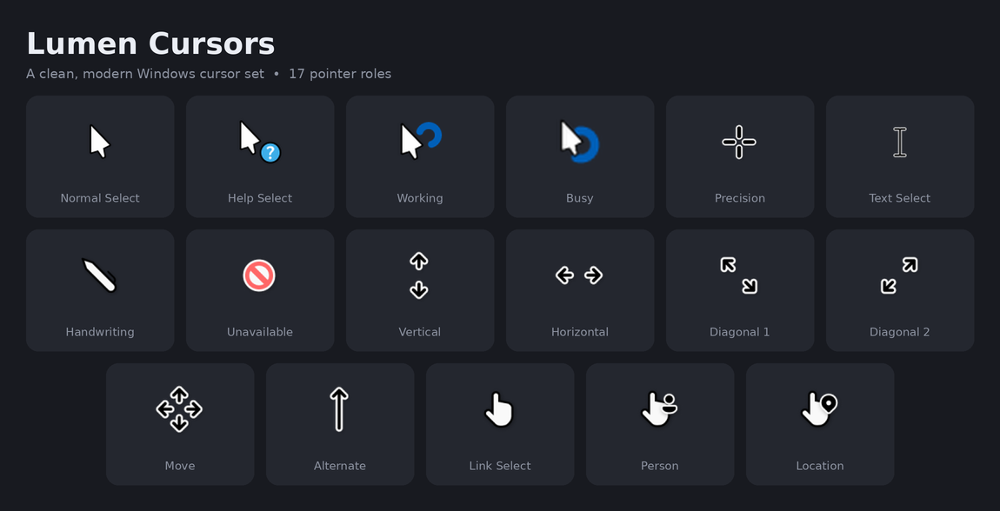

# Lumen Cursors

A clean, modern, high-precision cursor theme with a crisp light aesthetic, smooth animations, and multi-DPI scaling. Built for **Windows 10/11**, **Linux**, and **Omarchy** (Hyprland / Arch).


---

## Preview



---

## Repository Structure

The repository is cleanly separated into two standalone folders:

```text
Lumen-Cursors/
├── Lumen-Windows/        # 🪟 Windows 10 & 11 cursor scheme
│   ├── Install.inf       # Right-click 1-click INF installer
│   ├── Uninstall.cmd     # 1-click uninstaller script
│   └── *.cur, *.ani      # All 17 native Windows cursor files
│
├── Lumen-Linux/          # 🐧 Linux, Omarchy & Wayland/X11 cursor theme
│   ├── index.theme       # Standard theme descriptor (Theme: Lumen)
│   ├── cursors/          # 141 compiled Xcursor binaries and standard aliases
│   ├── install.sh        # Automated 1-step installer script
│   └── uninstall.sh      # Automated uninstaller script
│
├── assets/               # Previews and graphics
│   └── preview.png
│
├── LICENSE               # GNU Lesser General Public License v3.0
└── README.md             # Project documentation
```

---

## Features

- **Self-Contained Folders:** Windows files live exclusively in `Lumen-Windows/`; Linux files live exclusively in `Lumen-Linux/`.
- **Cross-Platform Out of the Box:** Native support for Windows 10/11, Linux (Wayland & X11), and Omarchy (Hyprland).
- **Full Role Coverage:** Covers all 17 pointer roles in Windows and 140+ standard X11 / FreeDesktop / CSS aliases in Linux.
- **Smooth Animations:** High-frame-rate animated *Working in Background* (37 frames) and *Busy* (36 frames) spinners with exact 33ms delays.
- **Multi-Resolution & HiDPI Ready:** Cursors scale crisply from 24px up to 96px for 4K displays and custom DPI scaling without blurring.
- **Dedicated Installers & Uninstallers:** Both platforms include dedicated automated scripts to install and uninstall effortlessly.

---

## Installation

### 🐧 Linux & Omarchy (Wayland / X11)

#### Option 1: Automated 1-Step Installation (Recommended)

Run the installer directly from your terminal:
```bash
cd Lumen-Cursors/Lumen-Linux
chmod +x install.sh
./install.sh
```
*(Or from the repository root: `bash Lumen-Linux/install.sh`)*

The installer automatically copies the theme to `~/.local/share/icons/Lumen` (and `~/.icons/Lumen`), configures default fallbacks, and applies the theme live to your active session.

#### Option 2: Manual Installation

1. Copy the `Lumen-Linux` folder as `Lumen` into your user icon directory:
   ```bash
   mkdir -p ~/.local/share/icons/Lumen
   cp -r Lumen-Linux/* ~/.local/share/icons/Lumen/
   ```
   *(For system-wide installation across all users, copy to `/usr/share/icons/Lumen` using `sudo mkdir -p /usr/share/icons/Lumen && sudo cp -r Lumen-Linux/* /usr/share/icons/Lumen/`)*.

2. Configure your desktop environment:

   - **Omarchy / Hyprland:**
     Add the following environment variables to your `~/.config/hypr/hyprland.conf`:
     ```ini
     env = XCURSOR_THEME,Lumen
     env = XCURSOR_SIZE,24
     env = HYPRCURSOR_THEME,Lumen
     env = HYPRCURSOR_SIZE,24
     ```
     To apply immediately in your active session:
     ```bash
     hyprctl setcursor Lumen 24
     ```

   - **GNOME / Ubuntu / Fedora:**
     Open **GNOME Tweaks** → **Appearance** → **Cursor** → select **Lumen**.  
     Or run in terminal:
     ```bash
     gsettings set org.gnome.desktop.interface cursor-theme 'Lumen'
     ```

   - **KDE Plasma:**
     Open **System Settings** → **Colors & Themes** → **Cursors** → select **Lumen** → click **Apply**.

   - **XFCE / Cinnamon / MATE:**
     Open your desktop's **Mouse and Touchpad** settings and pick **Lumen** under the Theme tab.

   - **X11 Fallback (`~/.Xresources`):**
     Add the line:
     ```
     Xcursor.theme: Lumen
     Xcursor.size: 24
     ```
     And reload with `xrdb -merge ~/.Xresources`.

---

### 🪟 Windows 10 & 11

1. Open the **`Lumen-Windows`** folder.
2. Right-click on **`Install.inf`** and select **Install** (on Windows 11, click *Show more options* if needed).
3. Open **Settings** → **Bluetooth & devices** → **Mouse** → **Additional mouse settings**.
4. Switch to the **Pointers** tab, select **Lumen** from the **Scheme** drop-down menu, and click **Apply**.

---

## Included Cursors & Roles

| Role | Windows File (`Lumen-Windows/`) | Linux / Wayland Targets (`Lumen-Linux/`) |
| :--- | :--- | :--- |
| **Normal Select** | `arrow.cur` | `default`, `left_ptr`, `arrow`, `top_left_arrow`, `right_ptr` |
| **Link Select** | `link.cur` | `pointer`, `pointing_hand`, `hand`, `hand1`, `hand2`, `openhand` |
| **Working in Background** | `working.ani` | `progress`, `half-busy`, `left_ptr_watch` |
| **Busy** | `busy.ani` | `wait`, `watch` |
| **Text Select** | `beam.cur` | `text`, `ibeam`, `xterm`, `vertical-text` |
| **Help Select** | `help.cur` | `help`, `left_ptr_help`, `question_arrow`, `whats_this` |
| **Precision Select** | `precision.cur` | `crosshair`, `cross`, `tcross`, `cell`, `plus` |
| **Unavailable** | `unavailable.cur` | `not-allowed`, `circle`, `crossed_circle`, `forbidden`, `no-drop` |
| **Move / Pan** | `move.cur` | `move`, `fleur`, `size_all`, `all-scroll`, `grabbing`, `closedhand` |
| **Vertical Resize** | `vert.cur` | `ns-resize`, `n-resize`, `s-resize`, `size_ver`, `v_double_arrow` |
| **Horizontal Resize** | `horz.cur` | `ew-resize`, `e-resize`, `w-resize`, `size_hor`, `h_double_arrow` |
| **Diagonal Resize 1** | `dgn1.cur` | `nwse-resize`, `nw-resize`, `se-resize`, `size_fdiag` |
| **Diagonal Resize 2** | `dgn2.cur` | `nesw-resize`, `ne-resize`, `sw-resize`, `size_bdiag` |
| **Alternate Select** | `alternate.cur` | `up-arrow`, `up_arrow`, `sb_up_arrow` |
| **Handwriting** | `handwriting.cur` | `pencil`, `draft`, `pen` |
| **Person Select** | `person.cur` | `person`, `user` |
| **Location Select** | `pin.cur` | `pin`, `location`, `target` |

---

## Uninstallation

### 🐧 Linux & Omarchy

Run the uninstall script:
```bash
bash Lumen-Linux/uninstall.sh
```
Or delete the installed folder manually:
```bash
rm -rf ~/.local/share/icons/Lumen ~/.icons/Lumen
```

### 🪟 Windows 10 & 11

#### Option 1: Automated 1-Click Uninstaller (Recommended)
1. Open the `Lumen-Windows` folder.
2. Right-click **`Uninstall.cmd`** and select **Run as administrator**.  
   *(The script deletes the registry scheme and removes the installed files from `C:\Windows\Cursors\Lumen_Cursors`)*.

#### Option 2: Manual Removal
1. Open **Additional mouse settings** → **Pointers** tab.
2. Select **Windows Default** from the drop-down menu and click **Apply**.
3. Select **Lumen** in the drop-down and click **Delete**.
4. Delete the folder `C:\Windows\Cursors\Lumen_Cursors`.

---

## Disclaimer

This project does not claim ownership of the original cursor artwork it is based on. All rights remain with the original authors.

Parts of this pack are based on [Capitaine Cursors](https://github.com/keeferrourke/capitaine-cursors) by Keefer Rourke, which is licensed under the LGPLv3. A copy of the license is included in the `LICENSE` file.

---

## License

Distributed under the GNU Lesser General Public License v3.0. See [LICENSE](LICENSE) for details.
